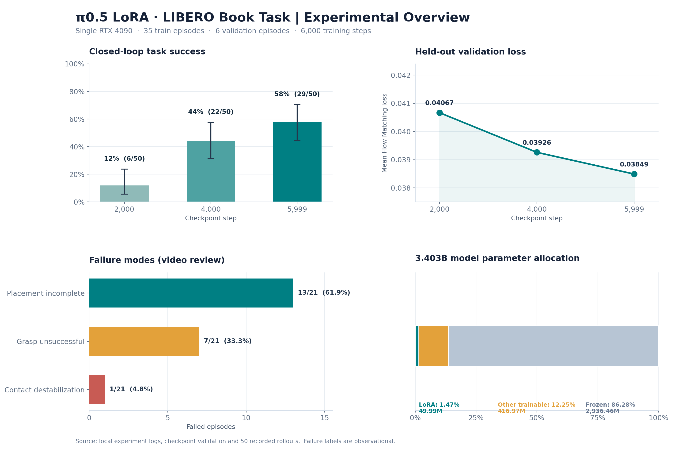
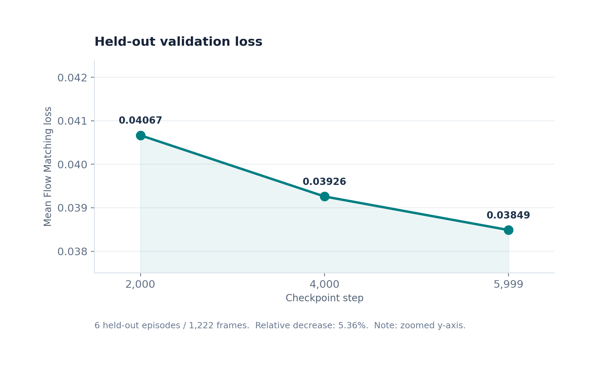
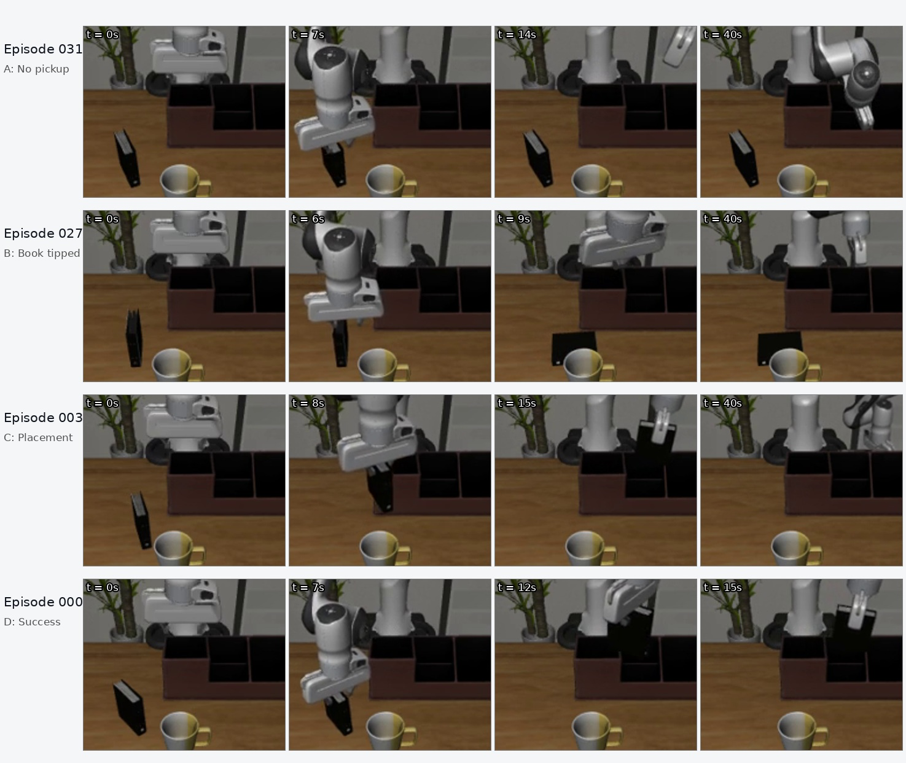

# π0.5 VLA LoRA 微调与 LIBERO 机器人操作策略学习

**π0.5 Vision-Language-Action Fine-Tuning · Flow Matching · JAX/Flax · LIBERO**

基于 [Physical Intelligence / openpi](https://github.com/Physical-Intelligence/openpi) 的 π0.5（π₀.₅）模型，从 `pi05_base` 出发，在**单张 NVIDIA RTX 4090（24 GB）** 上开展 LoRA + 部分非 LLM 参数微调。围绕机器人书本抓取放置任务，构建 **Episode 级数据筛选 → 训练 → 独立验证 → 闭环评测 → 失败分析** 的实验闭环。

> **核心结果：** 采用同一单任务训练轨迹的 Step 2000 / 4000 / 5999 checkpoint，LIBERO 闭环成功率分别为 **12%（6/50）、44%（22/50）、58%（29/50）**；6 条未参与训练的验证 Episode 上，Flow Matching Loss 从 **0.040666** 降至 **0.038488**（相对下降 **5.36%**）。
>
> **基线说明：** 此前在完整 LIBERO-10 上复现 *官方已微调的* `pi05_libero` checkpoint，结果为 **93.8%（469/500）**。这**不是本项目从 Base 微调模型的结果**，且多任务与单任务评测范围不同，不能作为同等训练预算的直接对照。



## 1. 项目目标与技术路线

目标是在有限 GPU 资源下验证：**连续动作生成式 VLA 模型能否通过少量示教完成目标机器人操作？训练阶段的监督损失与闭环任务成功率有什么关系？**

```text
多视角 RGB（3 路） + 任务语言 + 8D 机器人状态
                     │
                     ▼
               π0.5 VLA
       PaliGemma + Action Expert
                     │
          Flow Matching 监督学习
                     │
          10 × 32D 模型内部动作块
                     │  动作映射 / 反归一化
                     ▼
             10 × 7D LIBERO 动作
                     │
             LIBERO 闭环仿真环境
                     │
         成功率 / 失败视频 / 验证 Loss
```

**本人工作范围：** 训练配置与冻结参数核验、LeRobot Episode 级数据过滤、归一化数据准备、LoRA 微调和 checkpoint 管理、验证集评估、LIBERO 任务成功率评测与失败轨迹诊断。**π0.5 模型结构与上游 openpi 框架来自官方开源项目，不声称自行提出模型结构或 Flow Matching 算法。**

## 2. 数据集与实验任务

数据来源：[physical-intelligence/libero](https://huggingface.co/datasets/physical-intelligence/libero)（LeRobot 格式；40 个任务、1693 条 Episode、273465 帧）。

本项目的定向训练任务为：

> **Pick up the book and place it in the back compartment of the caddy**

| 项目 | 设定 |
|---|---|
| LeRobot 原始数据集 `task_index` | `09` |
| LIBERO-10 仿真评测脚本任务索引 | `5`（**不是** `09`） |
| 训练集 | **35** 条 Episode，**6412** 帧 |
| 独立验证集 | **6** 条 Episode，**1222** 帧 |
| Episode 划分随机种子 | `7` |
| 原始机器人状态 | 8D，送入模型前填充至 32D |
| 原始控制动作 | 7D，送入模型前填充至 32D |
| 动作序列长度 | 10（Action Horizon） |
| 图像 | `base_0_rgb`、`left_wrist_0_rgb`、`right_wrist_0_rgb`，224×224 |
| 数据归一化 | 仅用 **35 条训练 Episode** 计算分位数统计；checkpoint 保存相同统计量 |

数据划分保存在 [`results/train_episodes.json`](results/train_episodes.json) 与 [`results/val_episodes.json`](results/val_episodes.json)。验证 Episode 不参加训练及归一化统计量拟合。

### Episode 索引与 Action Chunk 边界

筛选 LeRobot v2.0 数据时，直接向 `LeRobotDataset(episodes=[...])` 传入不连续的原始 Episode ID，曾遇到 `IndexError: index 47 is out of bounds for dimension 0 with size 35`。本地解决办法是：

1. 先加载保留完整 Episode 边界索引的 LeRobotDataset；
2. 根据原始 `episode_index` 找到目标任务对应的帧索引；
3. 使用 `torch.utils.data.Subset` 只暴露选中帧，不重置底层 Episode 边界；
4. 校验训练样本数为 **6412**，并逐帧验证采样未越过指定 Episode。

这样不需要把连续但属于不同 Episode 的帧拼接成同一 Action Chunk。**`Subset` 改动属于本项目针对当前 LeRobot 版本的数据管线适配，并不是对所有版本都适用的通用修复。**

## 3. 模型微调配置

| 参数 | 实际配置 |
|---|---|
| 初始化权重 | `gs://openpi-assets/checkpoints/pi05_base/params` |
| 模型 | `Pi0Config(pi05=True)` |
| PaliGemma | `gemma_2b_lora` |
| Action Expert | `gemma_300m_lora` |
| 框架 | JAX / Flax NNX |
| 优化器 | AdamW；梯度裁剪范数 `1.0` |
| Batch Size | `1` |
| 训练步数 | `6000` |
| LR Schedule | Cosine decay，warmup `200` 步，峰值 `2.5e-5`，结束 `2.5e-6` |
| EMA | 关闭 |
| Checkpoints | Step `2000` / `4000` / `5999` |
| 硬件 | 1 × RTX 4090（24 GB） |

### LoRA 不是“仅训练 LoRA”

模型参数量来自 **本地 Flax NNX 参数树和 `trainable_filter` 实际统计**：

| 参数类别 | 参数量 | 占总模型比例 |
|---|---:|---:|
| 总参数量 | **3,403,421,456** | 100% |
| LoRA 参数 | **49,987,584** | 1.47% |
| 非 LoRA 可训练参数 | **416,969,488** | 12.25% |
| **可训练参数合计** | **466,957,072** | **13.72%** |
| 冻结参数 | **2,936,464,384** | **86.28%** |


## 4. 实验结果

### 4.1 同一训练轨迹的闭环评测

三个 checkpoint 均针对同一书本操作任务；每个 checkpoint 执行 50 次闭环仿真，使用 `seed=7`、`replan_steps=5`、`action_horizon=10` 的相同评测设置。

| Checkpoint | 成功 | 失败 | 任务成功率 | 对 Step 2000 的绝对变化 |
|---|---:|---:|---:|---:|
| Step 2000 | 6 | 44 | **12%** | — |
| Step 4000 | 22 | 28 | **44%** | +32 pp |
| Step 5999 | 29 | 21 | **58%** | **+46 pp** |


### 4.2 独立验证集 Flow Matching Loss

训练以外保留 **6 条 Episode（1222 帧）**，三个 checkpoint 使用相同的验证样本、随机种子 `7`、评估模式（`train_mode=False`），计算平均 Flow Matching Loss：

| Checkpoint | 验证样本数 | 验证集 Mean Flow Matching Loss ↓ |
|---|---:|---:|
| Step 2000 | 1222 | 0.040665811 |
| Step 4000 | 1222 | 0.039259399 |
| Step 5999 | 1222 | **0.038487841** |



从 Step 2000 到 5999，验证 Loss 相对下降 **5.36%**，同期闭环成功率由 **12% 升至 58%**。两者呈一致改善趋势，但**离线 Flow Matching Loss 与任务成功率不是同一指标**，这三个时间点不支持简单线性关系或因果解释。

### 4.3 与官方模型的关系

- **官方已微调 `pi05_libero` checkpoint 的本地基线复现：** LIBERO-10 共 500 次仿真，**93.8%（469/500）**；其中书本任务为 **50/50**。
- **本项目的单任务模型：** 从 `pi05_base` 出发，35 条书本示教训练 6000 步，书本任务 **29/50**。
- **不可直接比较的原因：** 两者使用的训练数据范围、训练预算和模型更新策略不同；前者是官方已训练好的多任务 checkpoint，后者是本人单卡训练的单任务 checkpoint。

另有早期诊断实验：在全部 40 个任务上用 `batch_size=1` 微调 2000 步，LIBERO-10 每任务 1 次测试结果为 **0/10**。因训练数据范围、LR 调度、实验任务与评测样本量同时变化，**不将 0/10→58% 解释成任务筛选带来的独立因果提升**。

## 5. 21 次失败轨迹分析

最终模型 Step 5999 共 50 次测试：成功 29 次，失败 21 次。通过单路 `agentview` 视频人工复核，按**最早可见的关键失败环节**对 21 次失败作互斥分类：

| 失败类型 | 数量 | 失败样本占比 | 视频观察 | 后续算法方向 |
|---|---:|---:|---|---|
| 入盒 / 放置未完成 | **13** | **61.9%** | 书本移到盒口附近，反复调整直至超时 | 后隔间目标几何、放置深度、松爪时序、接触反馈 |
| 抓取未成功 | **7** | **33.3%** | 书本仍留在桌面，机械臂却继续朝盒区运动 | 夹爪动作时序、抓取确认、失败恢复 |
| 接触碰倒 / 失稳 | **1** | **4.8%** | 接近抓取时碰倒书本，未成功恢复 | 接触控制、薄物体夹持稳定性 |



- **Episode 031（抓取失败）**：书本未被拿起，机械臂仍进入盒区；优先排查抓取成功状态反馈及恢复机制。
- **Episode 027（接触失稳）**：接近书本时碰倒物体；优先排查接近轨迹和夹爪姿态。
- **Episode 003（放置未完成）**：书本已到盒口，仍反复调整到超时；优先排查后隔间定位、深度和释放时序。

完整逐 Episode 标注：[`reports/failure_analysis_21.md`](reports/failure_analysis_21.md)，结构化数据：[`results/failure_cases.csv`](results/failure_cases.csv)。

> **重要限制：** 分类来自单视角视频，描述的是可见现象，**不能直接证明模型内部是否具有阶段判断能力**；应结合夹爪状态、书本 3D 位姿、目标区域和终止条件确认根因。

## 6. 本地复现指引

**环境前提：** 本项目是在已安装、可运行的 openpi fork 上完成。下面命令依赖本地新增的 `pi05_libero_book_lora` 配置、Episode 过滤适配和 `eval_book.py` / `eval_book_val_loss.py`。**本 README 图表包不包含你的私有服务器源码改动，公开仓库时请补充实际运行过的代码或对应 patch**，不要仅靠 README 声称新拉取的官方 openpi 可直接执行。

### 6.1 配置与 Episode 划分

```bash
cd ~/xyj/openpi
# 在仓库根目录保存本 README 附带的 results/train_episodes.json、val_episodes.json
# 并确保 src/openpi/training/config.py 中已注册 pi05_libero_book_lora
# 确保 data_loader.py 支持 OPENPI_EPISODES_FILE + 原始 Episode 索引完整性检查
export OPENPI_EPISODES_FILE="$PWD/results/train_episodes.json"
```

如果把附件目录放到仓库子目录而不是根目录，请相应调整 `OPENPI_EPISODES_FILE` 的路径。你最初在服务器使用的路径是 `results/book_task09/train_episodes.json`。

### 6.2 训练集归一化统计

```bash
CUDA_VISIBLE_DEVICES=0 PYTHONFAULTHANDLER=1 \
./.venv/bin/python -u -c '
import openpi.training.checkpoints
import torch
import runpy
runpy.run_path("scripts/compute_norm_stats.py", run_name="__main__")
' --config-name pi05_libero_book_lora
```

统计量**只能从训练 Episode 计算**，不能混入验证 Episode。首次运行可能需要联网下载 LeRobot 数据；数据和 `pi05_base` 已缓存后，训练和评测可离线运行。

### 6.3 训练 6000 步

```bash
CUDA_VISIBLE_DEVICES=0 PYTHONFAULTHANDLER=1 \
XLA_PYTHON_CLIENT_MEM_FRACTION=0.95 \
./.venv/bin/python -u -c '
import openpi.training.checkpoints
import torch
import runpy
runpy.run_path("scripts/train.py", run_name="__main__")
' pi05_libero_book_lora --exp-name book_6k_v1
```

本实验保存的 checkpoint 目录为：

```text
checkpoints/pi05_libero_book_lora/book_6k_v1/
├── 2000/
├── 4000/
└── 5999/
```

### 6.4 LIBERO 闭环评测

服务端：

```bash
CUDA_VISIBLE_DEVICES=0 PYTHONFAULTHANDLER=1 \
./.venv/bin/python -u -c '
import openpi.training.checkpoints
import torch
import runpy
runpy.run_path("scripts/serve_policy.py", run_name="__main__")
' policy:checkpoint \
  --policy.config pi05_libero_book_lora \
  --policy.dir checkpoints/pi05_libero_book_lora/book_6k_v1/5999
```

LIBERO 客户端（使用项目的 Python 3.8 LIBERO 环境）：

```bash
source examples/libero/.venv/bin/activate
export PYTHONPATH="$PWD/third_party/libero${PYTHONPATH:+:$PYTHONPATH}"
CUDA_VISIBLE_DEVICES=0 python examples/libero/eval_book.py \
  --args.host 127.0.0.1 \
  --args.task-suite-name libero_10 \
  --args.num-trials-per-task 50 \
  --args.replan-steps 5 \
  --args.seed 7 \
  --args.video-out-path results/book_task09/eval/step5999_50/videos
```

Step 2000、4000 的评测只改变服务端 checkpoint 路径和视频输出目录，其他评测设置保持不变。

## 7. 实验局限与后续方向

- **数据量有限：** 单任务 35 条训练 Episode；不能据此推断跨任务泛化能力。
- **随机种子有限：** 当前每个 checkpoint 使用一套评测配置和 50 次测试；更严谨的结论需要多种随机初始化/多轮重复评测。
- **非纯 LoRA：** 仍有约 417M 非 LoRA 参数可训练；未来可设计纯 LoRA 与混合微调的受控对照。
- **Loss 与控制不同：** Flow Matching Loss 衡量示教分布上的速度场误差，不能单独代表闭环成功率。
- **失败视频只支持现象归类：** 可进一步记录末端/夹爪状态、物体位姿、目标区域与动作输出，验证放置失败的具体机制。
- **训练配置不是受控消融：** 40 任务 2000 步与单任务 6000 步同时改变了数据范围和学习率调度，不能把总体变化归因于单一因素。

## 8. 参考与致谢

- [Physical Intelligence / openpi](https://github.com/Physical-Intelligence/openpi) — π0.5 模型与 JAX 训练框架。
- [openpi training config](https://github.com/Physical-Intelligence/openpi/blob/main/src/openpi/training/config.py) — 官方训练配置及 LoRA 示例。
- [Physical Intelligence LIBERO dataset (Hugging Face)](https://huggingface.co/datasets/physical-intelligence/libero) — LeRobot 格式示教数据。
- [LIBERO benchmark](https://libero-project.github.io/) — 机器人操作任务基准与仿真环境。

本项目在上述开源工作上进行训练配置适配与实验评测, 模型权重、数据和第三方代码的发布需分别遵循原项目许可与使用条款。
